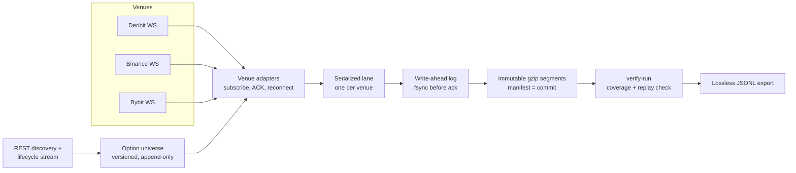

# Data Collector

A raw-first market-data recorder for crypto options and perpetuals. It records live WebSocket feeds from Deribit, Binance and Bybit byte-for-byte, writes each message to disk before it acknowledges it, and keeps an explicit, verifiable record of every gap in coverage.

The goal is a research archive of data **that cannot be downloaded later**: option order books, tickers and trades, perp top-20 books and liquidations. Those are gone once the moment passes. Anything a venue already offers as history (bars, funding, settlement prices) is fetched later and left out of live capture.

> **Status:** working pilot, not yet deployed as a 24/7 service. Hour-long runs have passed verification on a Linux VM. The combined three-venue run and the 24-hour VPS soak are still to do. See [PLANS.md](PLANS.md) for current status.

## What it captures

| Venue | Live feeds | Why live |
|---|---|---|
| Deribit BTC/ETH inverse options | top-20 book and ticker at 100 ms for every listed option, option trades, BTC/ETH index | no free book or ticker history |
| Binance USDⓈ-M perps | `bookTicker`, `depth20@100ms`, `aggTrade` for configured symbols; all-symbol liquidations | bookTicker archive ended in 2024; no depth-20 or liquidation archive |
| Bybit BTC/ETH options | per-symbol `tickers`, `publicTrade`, including PreLaunch listings | no option book, ticker or trade history |
| All three | instrument metadata (tick size, strikes, expiries), append-only | venues only publish current values |

The reasons behind each choice are in [docs/v2/COLLECTION_SCOPE.md](docs/v2/COLLECTION_SCOPE.md). Feeds that were looked at and left out are listed with reasons in [docs/v2/FEEDS.md](docs/v2/FEEDS.md).

## Measured results

From a one-hour Deribit options run on an Ubuntu 24.04 VM (6 vCPU, 6 GiB):

| Metric | Value |
|---|---:|
| Instruments / channels | 2,800 options / 8,400 channels across 4 worker processes |
| WebSocket messages | 10,993,156 (all records passed `verify-run`) |
| Native payload | 7.15 GB per hour, about 160 GiB per day |
| Compressed archive | 2.76 GB per hour, about 62 GiB per day |
| Peak memory / CPU | 481 MiB summed RSS, about 4 of 6 vCPUs |
| Faults handled | 3 server heartbeat closes, 94 failed DNS lookups; every worker reconnected and re-initialized, with each gap recorded |

A separate ten-minute run spanning the 08:00 UTC Deribit expiry passed verification across 13 universe versions: 118 expired options retired, new listings subscribed, and zero rejected subscriptions. Full numbers are in [PLANS.md](PLANS.md).

## How it works



Design decisions worth knowing:

- **Exact bytes, never re-encoded.** Each record keeps the original message bytes inside a versioned envelope (`dc.raw/2`) with receive time, monotonic clock, connection ID, sequence number and config hash. Prices stay as the venue's own strings, so nothing is lost to float conversion.
- **Durable before acknowledged.** A single writer owns a framed write-ahead log and fsyncs before a record counts as captured. After a crash, the damaged tail is kept for inspection, the good prefix is sealed, and capture resumes under a new session ID, so no gap is hidden.
- **Gaps are data.** Disconnects, reconnects, rejected subscriptions, clock problems and writer failures become `control` records. `verify-run` will not report coverage for an instrument until it has seen the subscription ACK and the first real update after every reconnect.
- **The universe follows listings.** Deribit lists new expiries at 08:00 UTC and adds strikes during the day. The collector listens to Deribit's `instrument.state` stream, runs a full REST audit every 300 seconds, and must subscribe each new option within 120 seconds of its creation. Bybit pre-lists the next expiry as `PreLaunch`; those options are subscribed as soon as discovery sees them. Each universe change is stored as a new version.
- **Scaled by partition.** Options are split across worker processes by stable symbol hash. Each worker owns its archive; a supervisor starts and stops them together and checks coverage across all partitions. Bybit subscriptions are spread over connections to stay under its per-connection argument limits.
- **Clock honesty.** Receive timestamps are never adjusted. Clock offset and uncertainty are sampled from chrony and recorded beside the data, so later analysis can judge time quality.

## Quick start

Requires Python 3.12. No API keys are needed; every feed is public.

```sh
python3.12 -m venv .venv
.venv/bin/python -m pip install -r requirements.lock
.venv/bin/python -m unittest discover -s tests        # 755 tests, about 5 minutes, loopback only
```

Check a configuration (this works on macOS):

```sh
.venv/bin/python -m data_collector config-check --config config/v2-bybit-options.toml
```

Live capture runs on Linux with chrony. Copy a config, pick `production` or `testnet`, set a fresh `data_root`, then:

```sh
.venv/bin/python -m data_collector discover   --config my-config.toml
.venv/bin/python -m data_collector capture    --config my-config.toml
.venv/bin/python -m data_collector verify-run <printed-root> --export out.jsonl
```

[docs/v2/RUNNING.md](docs/v2/RUNNING.md) covers configs for each venue, disk requirements and running in a Lima VM.

## Repository layout

| Path | Contents |
|---|---|
| `data_collector/` | v2 collector: venue adapters, write-ahead log, segment publisher, discovery, supervision, verification and replay (about 14,000 lines) |
| `option_collector/` | v1 Deribit REST snapshot collector, kept working for compatibility |
| `tests/` | `unittest` suites using synthetic fixtures and recorded venue replies (about 13,000 lines) |
| `config/` | example configs for each venue profile |
| `deploy/` | systemd units and installer for Linux hosts |
| `experiments/` | bounded live probes and research notebooks |

## Documentation

- [SPEC.md](SPEC.md): v2 contracts for record formats, ordering, gaps and adapters
- [docs/v2/COLLECTION_SCOPE.md](docs/v2/COLLECTION_SCOPE.md): what is recorded live and why
- [docs/v2/FEEDS.md](docs/v2/FEEDS.md): feed catalogue and per-venue limits
- [docs/v2/RUNNING.md](docs/v2/RUNNING.md): how to run and verify a capture
- [docs/v2/ACCEPTANCE.md](docs/v2/ACCEPTANCE.md): production acceptance gates
- [docs/v2/SNAPSHOTS.md](docs/v2/SNAPSHOTS.md): snapshot, replay and validity-correction rules
- [PLANS.md](PLANS.md): current status and next steps; [docs/v2/history/](docs/v2/history/) holds the earlier development log
- v1: [docs/SPEC_V1.md](docs/SPEC_V1.md), [docs/OPERATIONS.md](docs/OPERATIONS.md)
- Research: [docs/RESEARCH_DATA_SUFFICIENCY.md](docs/RESEARCH_DATA_SUFFICIENCY.md), [docs/EXPERIMENT_REPORT.md](docs/EXPERIMENT_REPORT.md)

## Roadmap

1. One run of at least an hour with all three venues together, spanning the 08:00 UTC expiry.
2. Deploy to a VPS and pass a 24-hour soak test.
3. Add derived layers (book snapshots, replay products) when a research use needs them.
