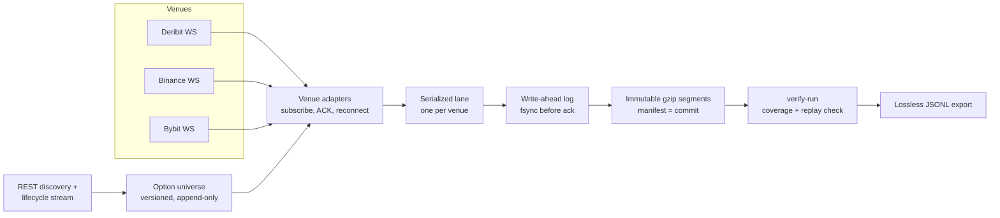

# Data Collector

A raw-first market-data recorder for crypto options and perpetuals on Deribit, Binance and Bybit. It keeps each venue reply byte-for-byte with its send, receive and venue times, and records every missed minute or dropped connection as an explicit gap.

The goal is an archive of data **that has no free history**, recorded on one 1-minute grid shared by all three venues, plus three small event streams. Anything a venue already offers as history (trades, bars, funding, perp order books) is downloaded later and left out of live capture.

> **Status:** the shared minute grid and the three continuous event streams are runnable on `minute-grid`. See [PLANS.md](PLANS.md) for live evidence and acceptance status.

## What it captures

Every minute at :00 UTC:

| Venue | Data |
|---|---|
| Deribit | ticker for every BTC/ETH option and dated future (WebSocket sampler, last value per instrument each minute), futures book summary, five indexes, DVOL, BTC/ETH perpetual ticker |
| Bybit | option tickers per coin, order book (25 levels) for about 100 near-ATM short-dated options, BTC/ETH perp ticker |
| Binance USDⓈ-M | order book (20 levels) and open interest for about 100 symbols |

Continuously, as event streams: Binance all-symbol liquidations, Bybit liquidations for the hedge perps, and Bybit option trades. Instrument metadata for all three venues is stored when it changes, Bybit risk-limit tiers on change, and Bybit option settlement once a day.

The reasons behind each choice, what is downloadable and what was dropped are in [docs/v2/COLLECTION_SCOPE.md](docs/v2/COLLECTION_SCOPE.md). Every feed that was looked at and left out, including the 100 ms streams, is listed with its reason in [docs/v2/FEEDS.md](docs/v2/FEEDS.md).

## Measured results (100 ms path, historical)

These numbers come from the superseded 100 ms v2 capture. From a one-hour Deribit options run on an Ubuntu 24.04 VM (6 vCPU, 6 GiB):

| Metric | Value |
|---|---:|
| Instruments / channels | 2,800 options / 8,400 channels across 4 worker processes |
| WebSocket messages | 10,993,156 (all records passed `verify-run`) |
| Native payload | 7.15 GB per hour, about 160 GiB per day |
| Compressed archive | 2.76 GB per hour, about 62 GiB per day |
| Peak memory / CPU | 481 MiB summed RSS, about 4 of 6 vCPUs |
| Faults handled | 3 server heartbeat closes, 94 failed DNS lookups; every worker reconnected and re-initialized, with each gap recorded |

A separate ten-minute run spanning the 08:00 UTC Deribit expiry passed verification across 13 universe versions: 118 expired options retired, new listings subscribed, and zero rejected subscriptions. Full numbers are in the [archived plan](docs/v2/history/PLANS_2026-11-08.md).

## How it works

This describes the v2 WebSocket capture, which carries the event streams. The minute-snapshot service will reuse v1's REST transport and archive.



Design decisions worth knowing:

- **Exact bytes, never re-encoded.** Each record keeps the original message bytes inside a versioned envelope (`dc.raw/2`) with receive time, monotonic clock, connection ID, sequence number and config hash. Prices stay as the venue's own strings, so nothing is lost to float conversion.
- **Durable before acknowledged.** A single writer owns a framed write-ahead log and fsyncs before a record counts as captured. After a crash, the damaged tail is kept for inspection, the good prefix is sealed, and capture resumes under a new session ID, so no gap is hidden.
- **Gaps are data.** Disconnects, reconnects, rejected subscriptions, clock problems and writer failures become `control` records. `verify-run` will not report coverage for an instrument until it has seen the subscription ACK and the first real update after every reconnect.
- **The universe follows listings.** Deribit lists new expiries at 08:00 UTC and adds strikes during the day. Each universe change is stored as a new version; under the 1-minute scope the Deribit sampler subscribes new listings from stored metadata and retires expired options at 08:00 UTC.
- **Scaled by partition.** Options are split across worker processes by stable symbol hash. Each worker owns its archive; a supervisor starts and stops them together and checks coverage across all partitions. Bybit subscriptions are spread over connections to stay under its per-connection argument limits.
- **Clock honesty.** Receive timestamps are never adjusted. Clock offset and uncertainty are sampled from chrony and recorded beside the data, so later analysis can judge time quality.

## Quick start

Requires Python 3.12. No API keys are needed; every feed is public.

```sh
python3.12 -m venv .venv
.venv/bin/python -m pip install -r requirements.lock
.venv/bin/python -W error -m unittest discover -s tests
```

Check a configuration (this works on macOS):

```sh
.venv/bin/python -m data_collector config-check --config config/v2-bybit-options.toml
```

Live capture runs on Linux with chrony. Start the minute collector with its own fresh data root.

```sh
.venv/bin/python -m data_collector minute-capture --data-root data/minute-grid --minutes 1
```

For the continuous event streams, copy
`config/v2-binance.toml` or `config/v2-bybit-options.toml` to `my-events.toml`
and set a fresh `data_root`. Start `capture` directly with the copied config
and use the printed run directory as `RUN_ROOT`.

```sh
.venv/bin/python -m data_collector capture --config my-events.toml
.venv/bin/python -m data_collector verify-run RUN_ROOT --export out.jsonl
```

[docs/v2/RUNNING.md](docs/v2/RUNNING.md) covers configs for each venue, disk requirements and running in a Lima VM.

## Repository layout

| Path | Contents |
|---|---|
| `data_collector/` | v2 collector: venue adapters, write-ahead log, segment publisher, discovery, supervision, verification and replay (about 14,000 lines) |
| `option_collector/` | v1 Deribit REST snapshot collector, kept working for compatibility |
| `tests/` | `unittest` suites using synthetic fixtures and recorded venue replies (about 13,000 lines) |
| `config/` | example configs for each venue profile |
| `deploy/` | systemd units and installer for Linux hosts |
| `experiments/` | bounded live probes and research notebooks |

## Documentation

- [SPEC.md](SPEC.md): v2 contracts for record formats, ordering, gaps and adapters
- [docs/v2/COLLECTION_SCOPE.md](docs/v2/COLLECTION_SCOPE.md): what is recorded, at what cadence, and why
- [docs/v2/FEEDS.md](docs/v2/FEEDS.md): feed catalogue and per-venue limits
- [docs/v2/RUNNING.md](docs/v2/RUNNING.md): how to run and verify a capture
- [docs/v2/ACCEPTANCE.md](docs/v2/ACCEPTANCE.md): production acceptance gates
- [docs/v2/SNAPSHOTS.md](docs/v2/SNAPSHOTS.md): snapshot, replay and validity-correction rules
- [PLANS.md](PLANS.md): current status and measured evidence. The [history directory](docs/v2/history/) holds earlier scope and run records
- v1: [docs/SPEC_V1.md](docs/SPEC_V1.md), [docs/OPERATIONS.md](docs/OPERATIONS.md)
- Research: [docs/RESEARCH_DATA_SUFFICIENCY.md](docs/RESEARCH_DATA_SUFFICIENCY.md), [docs/EXPERIMENT_REPORT.md](docs/EXPERIMENT_REPORT.md)

## Roadmap

1. Verify the combined profile across 08:00 UTC on `minute-grid`. See [GitHub issue #1](https://github.com/KengThanabadee/data-collector/issues/1) for the spec and tickets.
2. Choose a VPS (decided last), then deploy with offsite backup.
3. Add derived layers when a research use needs them.
